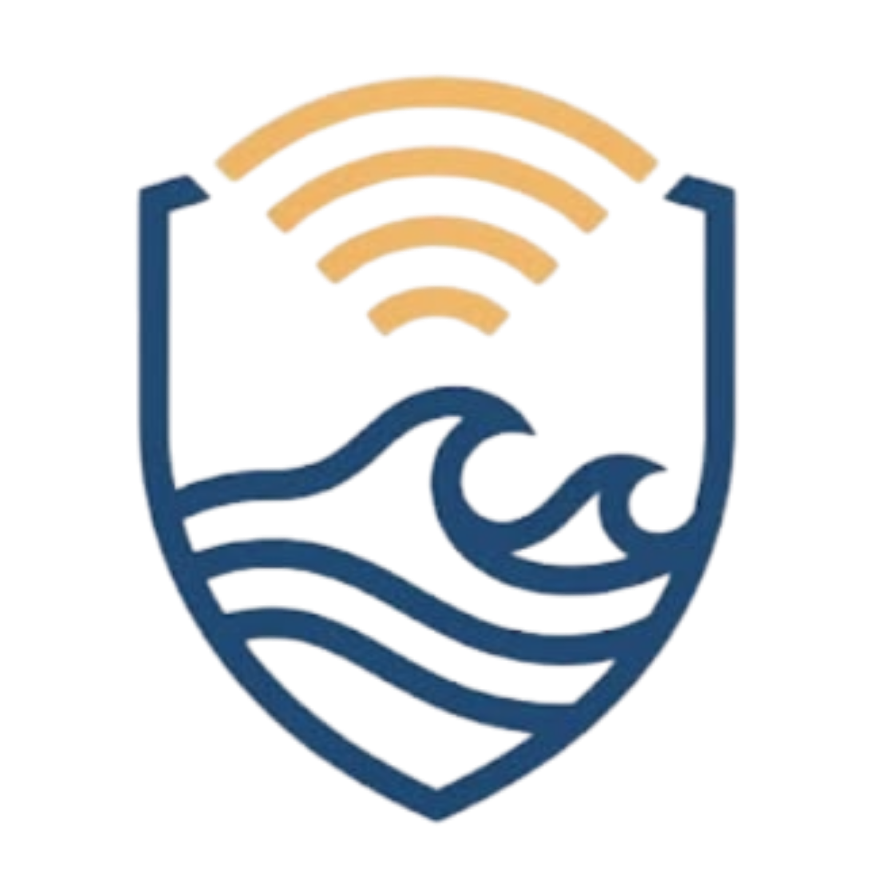

<p align="center">
  
</p>

<h1 align="center">SiagaKu</h1>

<p align="center">Emergency (SOS) and disaster incident reporting for citizens using AI-assisted verification for the support team.</p>

---

## Important Links & Demo Accounts

### 1. User / Citizens (Mobile)
- **App Download (APK):** [folder.felixfanady.com/s/siagaku-app](https://folder.felixfanady.com/s/siagaku-app)
- **Web App (Mobile):** [siagaku.felixfanady.com/app](https://siagaku.felixfanady.com/app)
- **Demo Account:** NIK `8888888888888888`

### 2. Admin & Support Team
- **Web Dashboard:** [siagaku.felixfanady.com](https://siagaku.felixfanady.com/)
- **Demo Admin:** `demo.admin` / `demo.bycode123`
- **Demo Support:** `demo.support` / `demo.bycode123`
- **Demo Face Verifier:** `demo.verif` / `demo.bycode123`

### 3. System & Backend
- **API Computer Vision Health Check:** [api-siagaku.felixfanady.com/health](https://api-siagaku.felixfanady.com/health)

---

## Tech Stack

- **Mobile App:** Flutter (Android, iOS, Web)
- **Frontend & API Console:** Next.js (TypeScript, Tailwind CSS)
- **Computer Vision Service:** Python, YuNet + SFace (Face Matching)
- **AI Verification:** OpenRouter API (Primary) & Google Gemini API (Fallback)
- **Infrastructure & Deployment:** Docker, Caddy Web Server, Vercel

---

## Current Progress (Status Proyek: 100% Selesai)

- [x] **Aplikasi Warga (Mobile):** Alur Login NIK, *Face Verification*, Fitur *One-tap SOS*, Pelaporan Bencana lengkap dengan foto/lokasi, dan *Alerts* wilayah sekitar.
- [x] **Dashboard Support & Admin (Web):** *Real-time report queue*, Peta Monitoring, Status Wilayah, Broadcast Peringatan, dan Verifikasi Ulang Wajah untuk aksi krusial.
- [x] **Service Computer Vision & AI:** *Health check endpoint*, *face matching pipeline* (YuNet + SFace) via Docker, serta validasi otomatis laporan bencana berbasis data BMKG & portal berita.
- [x] **Deployment & Production Ready:** Seluruh komponen (*Mobile App*, *Web Console*, dan *CV Engine*) telah terintegrasi penuh dan di-*deploy* pada server publik.

---

## Features

- **Citizens:** NIK login with face verification, one-tap SOS, incident reports with photo and location, and nearby alerts.
- **Support team:** Real-time report queue, monitoring map, region status, and alerts sent to nearby or all citizens.
- **AI verification:** Each report is checked against BMKG earthquake data and recent news. OpenRouter free models are tried first, with Google Gemini as the fallback.
- **Admin:** Support accounts with assigned provinces, citizen management, login logs, and face re-verification before high-privilege actions.

---

## Project Structure

| Folder | Description |
| :--- | :--- |
| `app/` | Flutter citizen app (Android, iOS, Web) |
| `frontend/` | Next.js admin & support console and the mobile API |
| `computer_vision/` | Face matching service (YuNet + SFace) behind Caddy, run with Docker |

---

## Running Locally

```bash
# 1. Clone Repository
git clone [https://github.com/username/SiagaKu.git](https://github.com/username/SiagaKu.git)
cd SiagaKu

# 2. Admin & Support Console + API (Next.js)
cd frontend
npm install
npm run dev        # Runs on http://localhost:3000
# Note: Copy frontend/.env.example to frontend/.env.local and fill in values

# 3. Citizen App (Flutter)
cd ../app
flutter pub get
flutter run        # Uses [https://siagaku.felixfanady.com](https://siagaku.felixfanady.com) by default

# 4. Computer Vision Service (Docker)
cd ../computer_vision
docker compose up -d --build